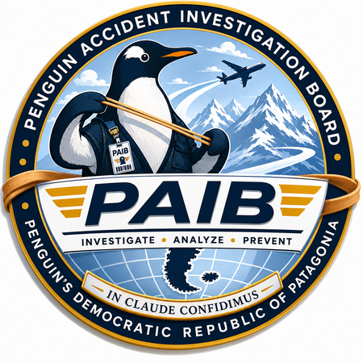

# Penguin Accident Investigation Board

**Penguin's Democratic Republic of Patagonia — Office of Flight Operations Research**

*Investigate · Analyze · Prevent*

---

## About the Board

The Penguin Accident Investigation Board (PAIB) is an independent technical
body responsible for investigating reported operational and performance
anomalies in flight simulation environments used by the Patagonian
aviation community, and for publishing its findings for public review.
Investigations are opened on receipt of credible community reports, are
conducted using instrumented, repeatable testing wherever possible, and
are published in full — methodology, raw data, and conclusions — regardless
of outcome.

This repository is the Board's public report archive.

## Published Reports

| Report No. | Title | Category | Date Issued | Status |
|---|---|---|---|---|
| [PAIB/2026/014](PAIB-2026-014-ground-taxi-turn-radius/) | Ground Taxi Turn Radius Performance Investigation — Boeing 747-400 | Technical Performance Review | 2026-08-14 | **Published** |
| [PAIB/2026/015](PAIB-2026-015-crosswind-landing-drift/) | Crosswind Landing Downwind Drift Rate Investigation — Boeing 747-400 | Technical Performance Review | 2026-08-15 | **Open** — follow-up recommended |
| [PAIB/2026/016](PAIB-2026-016-takeoff-roll-overspeed/) | Takeoff Roll Overspeed Anomaly Investigation — Boeing 747-400 | Incident Investigation | 2026-10-12 | **Published** — root cause identified |

## Report Contents

Each report directory contains:

- The published report (PDF)
- HTML source the report was rendered from
- The test harness / tooling used to gather evidence
- Raw data (logged tracks, console output) supporting the report's findings
- A `README.md` describing the archive contents and data provenance

## Distribution

All reports in this archive are released under distribution:
**UNRESTRICTED — PUBLIC RELEASE**, unless otherwise marked on the
individual report's cover page.

---

*"In Claude Confidimus"*

